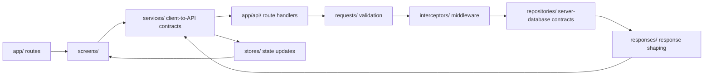
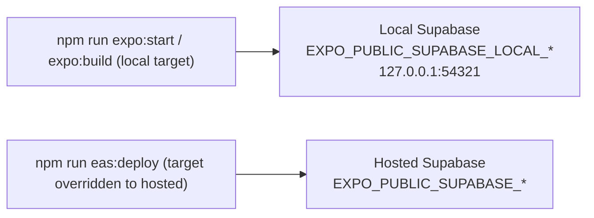

# Contributing

## Prerequisites
- Node.js/npm (Docker image uses Node 22)
- Docker + Compose for containerized runs and the local Supabase stack (PostgreSQL)
- `eas-cli` is invoked on demand via `npx` by the `eas:*` scripts; `gh` (GitHub CLI) is used by the `github:*` scripts (authenticated via `GH_TOKEN` in `.env`); Caddy is bundled in the Docker runtime, so use a local Caddy install for local Caddy commands; the Supabase CLI is invoked on demand via `npx` by the `supabase:*` scripts (not installed as a dependency)

## Setup
1. `npm ci`
2. Ensure `.env` exists and is **POSIX-compatible** (simple `KEY=value` lines): the Expo scripts source it, Caddy loads it with `--envfile`, and Node tooling can read it with `--env-file`.
3. **`.env` is the single source of truth for project configuration.** Do not add fallback/default values elsewhere; all required configuration must be defined in `.env`.
4. Keep both Supabase environments configured: local development (`EXPO_PUBLIC_SUPABASE_LOCAL_*`) and the hosted project used by Expo Hosting (`EXPO_PUBLIC_SUPABASE_*`).

## Development workflow
- The app is **web-only** (Expo Router, Metro, static web output with API routes). Do not assume native platforms are configured.
- Edit source in `src/` and root config (`app.config.js`, `metro.config.js`, `tailwind.config.js`, etc.). Do not edit generated artifacts in `build/` or `node_modules/`.
- Keep `src/screens/` mirroring `src/app/` route paths (page/API routes map to corresponding screen modules where applicable).
- Dev server: `npm run expo:start`. Tunnel: `npm run expo:start:tunnel`.
- Start the local Supabase stack before developing against data: `npm run supabase:start`; stop it with `npm run supabase:stop`. Use `npm run supabase:status` for local URLs/keys and `npm run supabase:reset` to re-apply migrations + seed.
- Add convenience/repeatable project commands as scripts in `package.json`; do not create a `scripts/` directory for them. Treat `package.json` scripts as the single source of truth for how to run and configure the project.
- Keep dependencies limited to what is actually imported/used. `devDependencies` holds workspace-local tooling that is not imported by the app; for example, `@supabase/supabase-js` is a runtime dependency, while the Supabase CLI is invoked via `npx`.

## Guides

### Project structure (tree)

Show the canonical up-to-date tree from `README.md` → **Project structure**.

### Diagrams & flowcharts (Mermaid)

Use **Mermaid** for diagrams/flowcharts in docs. Example: build & deploy pipeline:

## Routing & API conventions (Expo Router)
- File-based routes live in `src/app/`.
- API/special web routes use `+api` suffix naming, e.g. `api/health+api.js` → `/api/health`, `api/menu-items/+api.js` → `/api/menu-items`, `api/menu-items/[id]+api.js` → `/api/menu-items/:id`, `robots.txt+api.js`, `manifest.json+api.js`, `service-worker.js+api.js`. Handlers receive web `Request` and return `Response`.
- Root layout is `src/app/_layout.js`; custom document shell is `src/app/+html.js`.

### Adding a page/route
1. Create `src/app/<route>.js` and `export default` the screen component (React Native Web primitives with NativeWind `className`), keeping the screen itself under `src/screens/` when it grows.
2. Add the route to the **Routes & endpoints** table in `README.md`.

### Adding an API route
1. Create API routes with Expo Router `+api` naming. Use subdirectory `+api.js` for route segment indexes (consistent with UI `subdirectory/index.js` routing), e.g. `src/app/api/menu-items/+api.js`. Dynamic/specific route files may remain as direct `+api` files without a dedicated subdirectory when appropriate, e.g. `src/app/api/menu-items/[id]+api.js`. Use `export function GET()` (and other HTTP verbs when needed), receiving a web `Request` and returning a `Response`.
2. Set a correct `Content-Type` and sensible cache semantics.
3. Add the endpoint to the **Routes & endpoints** table in `README.md`.

### Supabase (local vs hosted)

- `EXPO_PUBLIC_SUPABASE_TARGET` selects the environment at build time: `local` (default) for development and local builds, `hosted` only when `npm run eas:deploy` runs. Never remove or bypass that override in the deploy script.
- Development and local builds always use the local stack (`EXPO_PUBLIC_SUPABASE_LOCAL_*`); only the Expo Hosting deploy uses the hosted project (`EXPO_PUBLIC_SUPABASE_*`). Selection happens in `src/database/instance.js` — never hardcode URLs/keys or add a cross-environment fallback.
- Use `getSupabase()` (or server helpers) from `src/database/instance.js` rather than calling `createClient()` in screens/routes.
- Never put a service-role key in client code, `EXPO_PUBLIC_*`, or `.env`; only anon/publishable keys belong in the browser.
- Schema changes: create a migration with `npm run supabase:migration -- <name>`, edit the SQL under `supabase/migrations/`, then run `npm run supabase:reset`. Verify with `npm run expo:build` and, when the local stack is running, by hitting `/api/menu-items` and `/api/auth/*`.
- Every table exposed through the Data API needs RLS enabled and explicit policies; keep writes restricted unless a screen truly needs them.
- Apply migrations to the hosted database with `npm run supabase:login` (once), `npm run supabase:link`, and `npm run supabase:push` (`SUPABASE_DB_PASSWORD` supplies the database password). `supabase:link` and the `opencode.json` Supabase MCP server both read the project reference from `SUPABASE_PROJECT_REF` in `.env`; do not hardcode it.

### API architecture & auth

Layered flow (client → server → client):

- **`src/app/`**: Expo Router pages and `+api.js` route handlers (HTTP/controller layer). Keep API handlers thin: compose interceptors, validate/parse via request modules, call repositories, and return route-matched responses.
- **`src/screens/`**: UI screens; make API calls through services and render/update from stores.
- **`src/services/`**: client-to-API contracts used by the UI (`auth.js`, `menu.js`, `admin.js`); send requests via shared HTTP utilities, parse/normalize API responses, and surface errors.
- **`src/requests/`**: route-matched incoming request handling/validation modules (mirroring API routes, e.g. `auth-sign-in.js`, `menu-items.js`, `admin-profiles.js`).
- **`src/interceptors/`**: interceptors `log-interceptor.js`, `error-interceptor.js`, `authentication-interceptor.js`, `authorization-interceptor.js`, `method-interceptor.js`, and `body-interceptor.js`. Compose routes with `src/network/middleware.js` and request context from `src/network/context.js`.
- **`src/repositories/`**: API-to-database/auth contracts and server-side data access/orchestration (`auth-repository.js`, `menu-repository.js`, `profile-repository.js`).
- **`src/responses/`**: route-matched outgoing API response shaping modules (mirroring API routes) with consistent no-store/error envelopes. Use shared primitives in `src/shared/response.js`.
- **`src/stores/`**: client state and DTO-style values/fields in Zustand (`auth-store.js`, `app-store.js`), updated from service/screen flows.
- **`src/errors/`**: global error modules, one file per error type (each exports an error class and factory), plus `normalize.js`. Covers network/API, database/Supabase, crypto/cipher, and other domain errors. Throw typed errors in layers and map them centrally to responses.
- **`src/network/`**: network/API utilities (`middleware.js` pipeline, `context.js` request context, `request.js`/`response.js` primitives, `http.js` client transport, `status.js` HTTP status constants).
- **`src/cipher/`**: cryptographic/encoding utilities (`encrypt.js`, `decrypt.js`, `encode.js`, `decode.js`, `hash.js`, `token.js`, `id.js`).
- **`src/database/`**: database/Supabase client instance and runtime selection (`instance.js`).
- **`src/shared/`**: cross-cutting infrastructure (`config.js` single source of truth for app/API/Supabase config). Do not add barrel `index.js` files in `interceptors/`, `requests/`, or `responses/`.
- Server-side Supabase access uses anon key + forwarded user tokens so RLS applies (`EXPO_PUBLIC_SUPABASE_TARGET` selects local vs hosted, no fallback; config composed in `src/shared/config.js`). In Docker, local routes reach Kong via `SUPABASE_LOCAL_SERVER_URL`. Never expose a service-role key. Usernames are public; internal Auth emails are never exposed. |

## Styling, state & config
- Use NativeWind/Tailwind classes (`className`) with React Native Web primitives. Global CSS is `src/stylesheets/global.css`.
- Use Zustand stores under `src/stores/` for shared client state.
- Tailwind content scans `src/**/*.{js,jsx,ts,tsx}`; dark mode is `class`-based.
- Client-visible config comes from `EXPO_PUBLIC_*` vars (see `src/shared/config.js`, `app.config.js`). `src/shared/config.js` is the single source of truth for composed app/API configuration (metadata and API endpoints/base path). Keep secrets out of `EXPO_PUBLIC_*`.

## Documentation conventions
- Always include JSDoc for modules with a top-level `@module` tag.
- Always add JSDoc for top-level exported functions and variables.
- Never include the `@example` tag in JSDoc.

## Verification
- No lint/test/typecheck scripts are configured. Manually verify changes with `npm run expo:build` (and `npm run expo:start`), and `npm run docker:build` if touching container/runtime config.
- `/api/health` should return `{ status: "ok", timestamp, uptime }` with `Cache-Control: no-store`.
- With the local Supabase stack running, `GET /api/menu-items` should list seeded menu items, `POST /api/auth/sign-in` with `{"username":"root","password":"root"}` should return a session/profile, `GET /api/auth/session` and `GET /api/admin/profiles` should require a valid bearer token (admin role for profiles), and `POST /api/auth/sign-out` should revoke the session.

## Documentation maintenance
- Keep `README.md` and `CONTRIBUTING.md` in sync with relevant changes (behavior, config, conventions, workflows).
- Document structure in tree form and use **Mermaid** for diagrams.

## Commits & PRs
- Commit messages use one of these tagged types:
  - `(feature)` — newly added feature
  - `(chore)` — documentation/configuration maintenance
  - `(ui)` — UI/UX changes
  - `(fix)` — bug and hot fixes
  - `(refactor)` — optimizations and code quality
- Format: a one-line short descriptive title after the tag, followed by a multi-line bulleted list of the individual changes.
- Commit automatically as work completes, without waiting for an explicit commit request. **Never push automatically** — pushing is always a deliberate action; deploys run through the push-to-deploy workflow (see `README.md` → Deployment).
