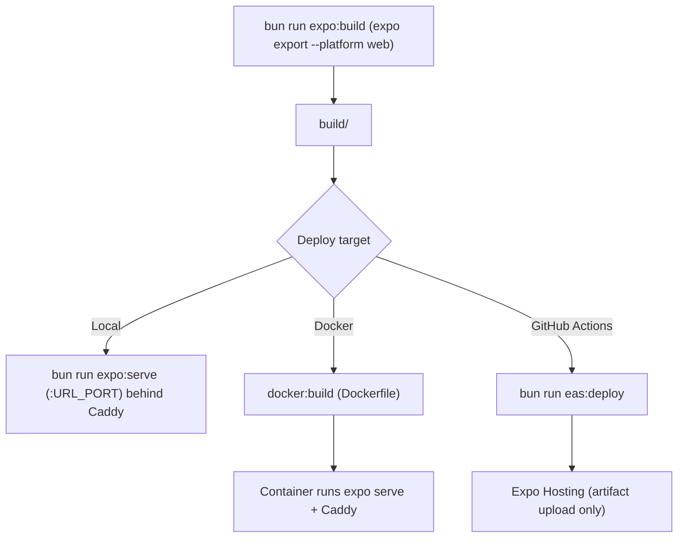
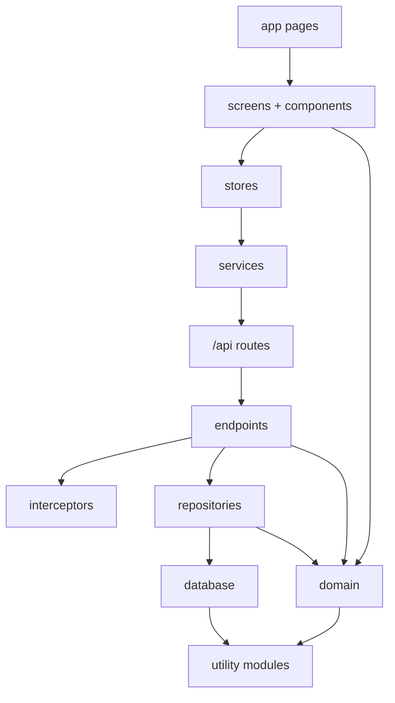
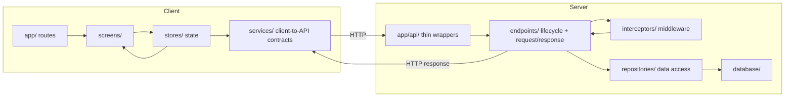
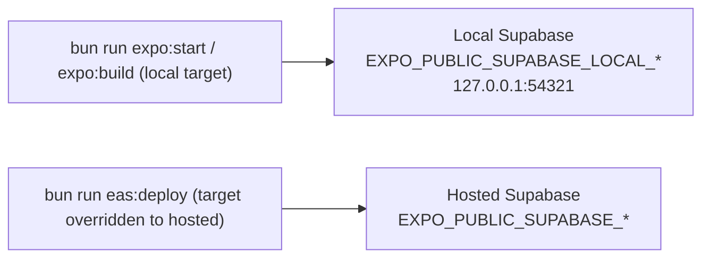

# Contributing

## Prerequisites
- Bun ≥1.4.5 is the only runtime (`bun install`, `bun run ...`, `bun run bun:test`); Docker image and CI use Bun 1.4.5 too.
- Docker + Compose for containerized runs and the local Supabase stack (PostgreSQL)
- `eas-cli` and the Supabase CLI are invoked on demand via `bun x --bun` by the `eas:*` / `supabase:*` launchers; `gh` (GitHub CLI) is used by the `gh:*` launchers (authenticated via `GITHUB_TOKEN` in `.env`); Caddy is bundled in the Docker runtime, so use a local Caddy install for local Caddy commands

## Setup
1. `bun install`
2. Ensure `.env` exists and is **POSIX-compatible** (simple `KEY=value` lines): launchers parse it via `system/environment.js`, Compose interpolates it and Caddy receives it through the process environment.
3. **`.env` is the single source of truth for project configuration.** Do not add fallback/default values elsewhere; all required configuration must be defined in `.env`.
4. Keep both Supabase environments configured: local development (`EXPO_PUBLIC_SUPABASE_LOCAL_*`) and the hosted project used by Expo Hosting (`EXPO_PUBLIC_SUPABASE_*`).

## Development workflow
- The app is **web-only** (Expo Router, Metro, static web output with API routes). Do not assume native platforms are configured.
- Edit source in the root-level directories (`app/`, `components/`, `constants/`, etc.) and root config (`app.config.js`, `metro.config.js`, `tailwind.config.js`, etc.). Do not edit generated artifacts in `build/` or `node_modules/`.
- Keep `screens/` mirroring `app/` route paths (page/API routes map to corresponding screen modules where applicable).
- Dev server: `bun run expo:start`. Tunnel: `bun run expo:start:tunnel`. The launcher injects `--port` from `URL_PORT` because Expo ignores the port env var.
- Start the local Supabase stack before developing against data: `bun run supabase:start`; stop it with `bun run supabase:stop`. Use `bun run supabase:status` for local URLs/keys and `bun run supabase:reset` to re-apply migrations + seed.
- `package.json` scripts are the single source of truth for tool invocations, but they call thin launchers in `scripts/` — do not put `set -a && . ./.env` or long shell pipelines in `package.json`. Launchers load `.env`, preserve argv order with `rawArguments()`, chdir to the root and spawn tools through `system/process.js`. Tool-specific behavior (port injection, token remapping, hosted target, asset copying) belongs in the relevant launcher.
- Keep dependencies limited to what is actually imported/used. `devDependencies` holds workspace-local tooling (`@opencode/cli`, `skills`); `@supabase/supabase-js` is a runtime dependency, while the Supabase and EAS CLIs are invoked on demand via `bun x --bun`.

## File format (all files)
| Rule | Value | Notes |
| --- | --- | --- |
| Indentation | 2 spaces | No tabs |
| Trailing whitespace | Trimmed | No spaces or tabs at line ends |
| Final newline | Inserted | Every text file ends with one newline |
| Line endings | LF | No CRLF |

Binary assets are exempt from the text-file rules.

### JSON/TOML
- Always expand `{}` and `[]`, including empty ones: opening and closing tokens go on their own lines. Put one value per line.
- Keep `package.json` `scripts` alphabetically ordered so each base command sits with its `:` variants.

```json
{
  "name": "Template",
  "scripts": {
  },
  "items": [
    "a",
    "b"
  ]
}
```

### JavaScript
Statement order: `import` statements, variable declarations, function declarations, `export {...}`, `export default`. Arrow functions assigned to `const` are declarations, so the function-declaration slot stays empty in `system/*` and `scripts/*`.

| Rule | Convention |
| --- | --- |
| Object/array literals | Expand when they hold 2 or more values, one value per line |
| Trailing commas | Trim them in JS files, including expanded literals, imports, exports and destructuring |
| Import/export/destructuring | Expand when they name 2 or more bindings |
| JSDoc | Always on public variables and functions, with `@param`/`@returns`; `@module` on app modules; never `@example` |
| Functions | Arrow functions only in `system/*` and `scripts/*`; Expo config modules use `export default function` |
| Language | Vanilla JavaScript (ESM); no TypeScript files or type annotations |
| Built-ins | Wrap the corresponding Node built-in instead of reimplementing it; scripts import only from `system/*`, never `node:*` directly |

Return values in `system/*` are literal data (objects, arrays, strings, numbers, booleans, arrow functions) — never `Date`, `URL`, or stream objects. A module with a real failure path imports its error factory from `errors/` and throws the centralized app error.

| Module | Failure behavior |
| --- | --- |
| `argument.js` | Throws `ArgumentError` for invalid input |
| `console.js` | Delegates to `node:console`; throws `ConsoleError` with `cause` for a failed built-in call |
| `date.js` | Returns `""` or a `valid: false` object for invalid input |
| `environment.js` | `load()` throws `EnvironmentError` with `cause`, except with `{ optional: true }`, which returns `{}` for a missing file |
| `io.js` | Throws `IoError` with `cause` |
| `os.js` | Cannot fail |
| `path.js` | Throws `PathError` for failed filesystem operations and missing paths in `details()` |
| `process.js` | `exec` and `spawn` return an `error` field; invalid commands throw `ProcessError` |
| `signal.js` | Cannot fail for valid signal names |
| `uri.js` | `url()` returns `null` for invalid input |

`console.js` exports `info`, `warn`, `error`, `debug`, `trace`; `debug(task, ...args)` times a sync/async task and prints only its elapsed duration, and object values use `util.inspect` at unlimited depth.

## Guides

### Project structure (tree)

Show the canonical up-to-date tree from `README.md` → **Project structure**.

### Diagrams & flowcharts (Mermaid)

Use **Mermaid** for diagrams/flowcharts in docs. Example: build & deploy pipeline:



## Architecture

This project is a **layered modular monolith**: one web app with thin routes, server use-case composition, data-access repositories, and a small pure domain layer.



### Dependency rules

Imports only point downward:

| Layer | May import |
| --- | --- |
| `app` | `app`, `screens`, `components`, `endpoints`, `services`, `stores`, `domain`, `utilities` |
| `screens` | `screens`, `components`, `stores`, `services`, `domain`, `utilities` |
| `components` | `components`, `stores`, `domain`, `utilities` |
| `stores` | `stores`, `services`, `domain`, `utilities` |
| `services` | `services`, `database` (realtime client), `domain`, `utilities` |
| `endpoints` | `endpoints`, `interceptors`, `repositories`, `domain`, `utilities` |
| `interceptors` | `interceptors`, `repositories`, `domain`, `utilities` |
| `repositories` | `repositories`, `database`, `domain`, `utilities` |
| `database` | `database`, `utilities` |
| `domain` | `domain`, `utilities` |
| `utilities` | `utilities` |

Here `utilities` means the root-level leaf directories `cipher/`, `constants/`, `errors/`, `format/`, `helpers/`, `network/`, `stylesheets/`, and `validation/`.

- `domain/*` holds pure business rules, constants, and Zod schemas. It must not import Supabase, React, HTTP, fetch, or browser APIs.
- The utility directories are a leaf layer of generic modules; they must not import business or UI layers.
- `repositories/*` perform data access only. Put business rules in `domain/*`.
- `endpoints/*` compose request validation, interceptors, repositories, and responses.
- `screens/*` must not import Supabase or server-only modules.
- `services/*` are client-to-API contracts; the realtime service may use the shared database client.
- Follow these boundaries when adding new modules; tests under `test/` mirror root module paths, and Playwright E2E specs use `*.e2e.js` under `test/app/`.

## Routing & API conventions (Expo Router)
- File-based routes live in `app/`.
- API/special web routes use `+api` suffix naming, e.g. `api/health+api.js` → `/api/health`, `api/items/+api.js` → `/api/items`, `api/items/[id]+api.js` → `/api/items/:id`, `robots.txt+api.js`, `manifest.json+api.js`, `service-worker.js+api.js`. Handlers receive web `Request` and return `Response`.
- Root layout is `app/_layout.js`; custom document shell is `app/+html.js`.

### Adding a page/route
1. Create `app/<route>.js` and `export default` the screen component (React Native Web primitives with NativeWind `className`), keeping the screen itself under `screens/` when it grows.
2. Add the route to the **Routes & endpoints** table in `README.md`.

### Adding an API route
1. Create an endpoint composition module in `endpoints/` (mirroring the `app/api/*` route structure) that implements the API lifecycle: compose the middleware pipeline (`network/middleware.js`, `interceptors/*`), parse requests with `readJsonBody`, validate/normalize with **Zod** schemas via `validation/*` helpers, call repositories (`repositories/*`), and shape responses, then export the HTTP method handlers (e.g. `endpoints/items/index.js`, `endpoints/items/[id].js`).
2. Create a thin Expo Router `+api` wrapper under `app/api/` that only exports those HTTP methods. Use subdirectory `+api.js` for route segment indexes (consistent with UI `subdirectory/index.js` routing), e.g. `app/api/items/+api.js` → `export { GET, POST, PUT, PATCH, DELETE } from "../../../endpoints/items.js"`. Dynamic/specific route files may remain as direct `+api` files without a dedicated subdirectory when appropriate, e.g. `app/api/items/[id]+api.js`.
2. Set a correct `Content-Type` and sensible cache semantics.
3. Add the endpoint to the **Routes & endpoints** table in `README.md`.

### Supabase (local vs hosted)

- `EXPO_PUBLIC_SUPABASE_TARGET` selects the environment at build time: `local` (default) for development and local builds, `hosted` for exports built with `--hosted` (as `bun run eas:deploy` does). The deploy script also overrides the target for the upload; never remove either override.
- Development and local builds always use the local stack (`EXPO_PUBLIC_SUPABASE_LOCAL_*`); only the Expo Hosting deploy uses the hosted project (`EXPO_PUBLIC_SUPABASE_*`). Selection happens in `database/instance.js` — never hardcode URLs/keys or add a cross-environment fallback.
- Use `getSupabase()` (or server helpers) from `database/instance.js` rather than calling `createClient()` in screens/routes.
- Never put a service-role key in client code, `EXPO_PUBLIC_*`, or `.env`; only anon/publishable keys belong in the browser.
- Schema changes are flattened by table: each migration under `supabase/migrations/` contains one table and its associated indexes, grants, RLS policies, helper functions, comments, and realtime publication. Do not reintroduce historical migration chains. After editing a table migration, run `bun run supabase:reset` and verify with `bun run expo:build` plus the relevant `/api/*` flows.
- Every table exposed through the Data API needs RLS enabled and explicit policies; keep writes restricted unless a screen truly needs them.
- Apply migrations to the hosted database with `bun run supabase:link` and `bun run supabase:push` using `SUPABASE_ACCESS_TOKEN` from `.env` for non-interactive CLI auth (or run `bun x --bun supabase login` once locally as needed). `supabase:link` and the `opencode.json` Supabase MCP server both read the project reference from `SUPABASE_PROJECT_REF` in `.env`; do not hardcode it.

### API architecture & auth

Layered flow (client → server → client):



- **`app/`**: Expo Router pages and `+api.js` route handlers (HTTP/controller layer). Keep API handlers thin: compose interceptors, validate/parse via request modules, call repositories, and return route-matched responses.
- **`screens/`**: UI screens; make API calls through services and render/update from stores.
- **`services/`**: client-to-API contracts used by the UI (`auth.js`, `audit.js`, `items.js`, `admin.js`, `orders.js`, `staff.js`); send requests via shared HTTP utilities, parse/normalize API responses, and surface errors.

- **`interceptors/`**: cross-cutting interceptors `log.interceptor.js`, `error.interceptor.js`, `authentication.interceptor.js`, `authorization.interceptor.js`, `method.interceptor.js`, and `body.interceptor.js`. Compose routes with `network/middleware.js` (pipeline and request context).
- **`repositories/`**: API-to-database/auth contracts and server-side data access/orchestration (`auth.repository.js`, `item.repository.js`, `profile.repository.js`).

- **`stores/`**: client state and DTO-style values/fields in Zustand (`auth.store.js`, `app.store.js`), updated from service/screen flows.
- **`errors/`**: global error modules, one file per error type (each exports an error class and factory), plus `normalize.js`. Covers network/API, database/Supabase, crypto/cipher, and other domain errors. Throw typed errors in layers and map them centrally to responses.
- **`network/`**: network pipeline/primitives (`middleware.js`, `context.js`, `request.js`, `response.js`, `transport.js` client transport).
- **`cipher/`**: cryptographic/encoding utilities (`encrypt.js`, `decrypt.js`, `encode.js`, `decode.js`, `hash.js`, `token.js`, `id.js`).
- **`helpers/`**: generic list, record, and QR helpers (`lists.js`, `records.js`, `qr-image.js`, `qr-upload.js`).
- **`format/`**: currency, date, and email formatting.
- **`validation/`**: reusable Zod and request-validation helpers.
- **`stylesheets/`**: global CSS entry (`global.css`), wired in `metro.config.js`.
- **`database/`**: database/Supabase client instance and runtime selection (`instance.js`).
- **`constants/`**: `config.js` (single source of truth for app/API/Supabase config), `theme.js` (global theme colors), and `http.js` (HTTP status constants). No barrel `index.js` files in `interceptors/` or `endpoints/`.
- Server-side Supabase access uses anon key + forwarded user tokens so RLS applies (`EXPO_PUBLIC_SUPABASE_TARGET` selects local vs hosted, no fallback; config composed in `constants/config.js`). In Docker, local routes reach Kong via `SUPABASE_LOCAL_SERVER_URL`. Never expose a service-role key. Profile emails are readable by authenticated users; never expose access tokens or staff credentials. |



## Styling, state & config
- Use Zod for all request validation. Put reusable schemas/helpers in `validation/` and domain-specific schemas next to their endpoints (e.g. `endpoints/items/validation.js`). Map parse failures to typed 4xx errors through `parseWithSchema`; never return raw Zod errors to clients.
- Build screens from reusable primitives in `components/`. Use `DataTable` for audit tables, `SectionHeader` for consistent section titles/syncing state, `StatGrid`/`StatCard` for metrics, `StatusPill` for statuses, and `FormActions` for form buttons. Interactive components must expose `disabled`/`loading` consistently and include accessibility roles/labels.
- Use NativeWind/Tailwind classes (`className`) with React Native Web primitives. Visual tokens are defined in `constants/theme.js` and documented in `DESIGN.md`; use them instead of raw colors or ad-hoc typography/spacing. Global CSS is `stylesheets/global.css`.
- Support wearable (`<640px`), phone (`sm:`), and tablet (`md:`+) viewports by following the responsive rules in `DESIGN.md`.
- Audit events are written by database triggers on profiles, items, orders, and order items. Only admins can read `audit_logs` through `/api/admin/audit-logs`; do not add client-side write paths.
- Use Zustand stores under `stores/` for shared client state. The `(customer)` group enforces the `customer` role, `(staff)` enforces `staff` (`/staff/order` and `/staff/records`), and `(admin)` enforces `admin` (analytics, audit logs, and edit screens). The profiles audit page lists every profile, including seeded accounts.
- Keep only `/` and `/signin` public. Customers use one shared guest profile via "Continue as guest"; do not add customer sign-up, account, or recovery flows back into the MVP. `/api/checkout` requires the guest token.
- Tailwind content scans the root-level app directories (see `tailwind.config.js`); dark mode is `class`-based.
- Client-visible config comes from `EXPO_PUBLIC_*` vars (see `constants/config.js`, `app.config.js`). `constants/config.js` is the single source of truth for composed app/API configuration (metadata and API endpoints/base path). Keep secrets out of `EXPO_PUBLIC_*`.

## Documentation conventions
- Name utility modules after their actual contents (for example `format/email.js` for email normalization, `helpers/records.js` for record comparison/update helpers). Avoid generic names like `string.js`, `misc.js`, or `utils.js`.
- Use dotted role suffixes: `*.screen.js`, `*.component.js`, `*.store.js`, `*.repository.js`, and `*.interceptor.js`. Error modules in `errors/` keep plain names (no `*.error.js` suffix).
- Always include JSDoc for modules with a top-level `@module` tag.
- Always add JSDoc for top-level exported functions and variables.
- Never include the `@example` tag in JSDoc.

## Verification
- Run `bun run check` and `bun run bun:test` before finishing any change to `system/*` or `scripts/*`; scripts are verified by running them. CI runs the suite with `--coverage --coverage-threshold=95`. `bun run playwright:test` runs the E2E specs over HTTPS through Caddy (both servers start automatically); install browsers once with `bun run playwright -- install chromium`.
- `Dockerfile` and `docker-compose.yml` are the single source of truth for containerized test/build/run: use `docker compose --profile test run --rm test-unit` (and `--profile build run --rm build` for static export). The local Penpot MCP runs from `docker-compose.penpot.yml` via `bun run penpot:local`.
- Manually verify changes with `bun run expo:build` (and `bun run expo:start`), and `bun run docker:build` / `bun run docker:up` if touching container/runtime/build config.
- `/api/health` should return `{ status: "ok", timestamp, uptime }` with `Cache-Control: no-store`.
- With the local Supabase stack running, `GET /api/items` should list seeded items, `POST /api/signin` with `{"email":"admin@paku-paku.official","password":"admin"}` (or staff `staff@paku-paku.official` / `staff`) should return a session/profile, `GET /api/session` and `GET /api/admin/profiles` should require a valid bearer token (admin role for profiles), and `POST /api/signout` should revoke the session.

## Documentation maintenance
- Keep `README.md` and `CONTRIBUTING.md` in sync with relevant changes (behavior, config, conventions, workflows).
- Document structure in tree form and use **Mermaid** for diagrams.

## Commits & PRs
- Commit messages use `(new)` (new features), `(fix)` (bug/hot fixes), `(refactor)` (code/optimization changes), `(chore)` (config/documentation) or `(ui)` (UI/UX changes).
- Format: `(prefix) <Short description>` where the description starts with an uppercase letter, e.g. `(new) Add env-aware Supabase launcher`.
- Commit automatically as work completes, without waiting for an explicit commit request. **Never push automatically** — pushing is always a deliberate action; deploys run through the push-to-deploy workflow (see `README.md` → Deployment).
